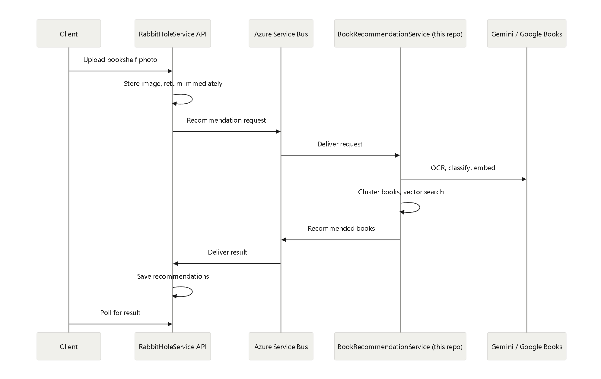

# RabbitHoleService

Live demo: https://rabbithole-service-e2dyd8ggc6dgdygr.australiaeast-01.azurewebsites.net/swagger

Recommendations are disabled in the hosted demo (see Hosting).

Companion worker service (BookRecommendationService): https://github.com/calvia17/BookRecommendationService

## Features

- JWT authentication with refresh-token rotation, reuse detection and access-token blacklisting
- Role-based access control with three roles: Admin, Staff and Customer
- Hybrid caching (in-memory, Redis)
- Redis-backed rate limiting, with stricter limits on login by IP address and username
- CRUD for books, customers, staff and orders, including bulk add and update for books
- Idempotent order creation and atomic stock updates
- Asynchronous recommendations from a bookshelf photo (request/reply over Azure Service Bus)
- BookSeeder console tool for pulling and seeding sample books

## Architecture

- The API handles all requests from the client.
- For recommendations, the API stores the image in Azure Blob Storage and sends a message to the BookRecommendationService over Azure Service Bus.
- It returns a correlation ID to the client, which can be used to poll for the recommendation result.
- The BookRecommendationService receives the message, downloads the image from Blob Storage, generates the book recommendations.
- It then sends the recommendations back to the API over Service Bus, which stores them in the database for retrieval by the client.
- If the worker service is down, Azure Service Bus will hold the message until the worker service is back up and running, ensuring that no requests are lost.



## Tech stack

- API: ASP.NET Core 10 (Web API), Swagger / OpenAPI
- Data access: Entity Framework Core 10, SQL Server
- Caching: Redis (distributed), in-memory cache
- Rate limiting: Redis
- Messaging: Azure Service Bus (queues)
- File storage: Azure Blob Storage
- Hosting: Azure App Service
- Book Seeding: Open Library API

## Authentication

- JWT with refresh-token rotation
- Access tokens are short-lived, so a leaked token has a limited window of use.
- Refresh tokens are long-lived, so users don't need to log in frequently. When an access token expires, the client exchanges its refresh token for a new access token.
- Refresh tokens are single-use. Each refresh issues a new refresh token and invalidates the old one.
- Refresh tokens are hashed and stored in the database, so a database leak doesn't expose usable tokens. Expired tokens are cleaned up periodically by a background service.
- Token revocation and breach detection: Access tokens are blacklisted (in Redis) when a user logs out or when a refresh token is reused (breach detection).

## Authorization

- Access is restricted by role to follow the principle of least privilege: sensitive endpoints are available only to the roles that need them.
- Role-based access control with three roles: Admin, Staff and Customer
- Unauthenticated users can only view books and register an account.
- Authenticated customers can manage their account and create orders.
- Staff can manage books, orders and customers.
- Admins can manage staff and have access to all endpoints.

## Hybrid Caching

- In-memory cache is checked first, then Redis if not found.
- In-memory cache is fast since it is stored on the same server.
- Redis is shared across all the instances and can survive application restarts.

## Redis rate limiting

- The API is rate limited to prevent abuse and protect it from being overwhelmed.
- The login endpoint is rate limited per IP address and per username to slow down brute-force attacks.
- It is backed by Redis, so the limits stay consistent if the API runs on multiple instances or if the service restarts.

## Data integrity

- Idempotent order creation: If a client retries an order request after a timeout or network failure, no duplicate order is created.
- Atomic stock updates: Stock changes are applied as atomic database updates, so concurrent orders for the same book can't oversell it.

## Book recommendations

- A customer uploads a photo of their bookshelf. The API stores the image, asks the worker for recommendations, and returns immediately. The client then polls for the result.
- The worker service receives the request, computes recommendations, and sends them back to the API through a queue. 
  The API stores the recommendations in the database for the client to retrieve.
- Since the processing is done asynchronously, the API can handle many requests without being blocked by the recommendation computation.
- This is done since the worker service needs to call external APIs to compute the recommendations. 
- Without an asynchronous approach, the API would be blocked while waiting for the external APIs to respond, which could take a long time and would prevent it from handling other requests.

## Hosting and CI/CD pipeline

- The API is hosted on Azure App Service (F1 tier): https://rabbithole-service-e2dyd8ggc6dgdygr.australiaeast-01.azurewebsites.net/swagger
- The CI/CD pipeline is implemented using GitHub Actions.
- Since it is hosted on the free tier, the API may take a few seconds to start up when it is idle for a while. This is expected behavior and is not a bug.
- Since the worker service cannot be hosted on the free tier, it is not deployed to Azure.
  So the recommendation endpoints are not accessible on the live demo. To test the recommendation endpoints, run both the API and the worker service locally.

## Prerequisites

- Visual Studio
- .NET 10 SDK
- SQL Server
- Redis
- For recommendations: an Azure Service Bus namespace with two queues (process and publish queues), an Azure Blob Storage account, and the worker service running

## Run locally

- Clone the repository and open the solution in Visual Studio or use command line.
- Add the project secrets:

   ```
   cd RabbitHoleService
   dotnet user-secrets set "ServiceBus:PublishQueueName" "<publish queue name>"
   dotnet user-secrets set "ServiceBus:ProcessQueueName" "<process queue name>"
   dotnet user-secrets set "ServiceBus:ConnectionString" "<Service Bus connection string>"
   dotnet user-secrets set "Jwt:Key" "<JWT signing key>"
   dotnet user-secrets set "ConnectionStrings:Redis" "<Redis connection string>"
   dotnet user-secrets set "ConnectionStrings:DefaultConnection" "<SQL Server connection string>"
   dotnet user-secrets set "BlobStorage:ShelfImageContainer" "<Blob Storage container name>"
   dotnet user-secrets set "BlobStorage:ConnectionString" "<Blob Storage connection string>"
   dotnet user-secrets set "Admin:Email" "<admin email>"
   dotnet user-secrets set "Admin:Password" "<admin password>"
   dotnet user-secrets set "OpenLibrary:ContactEmail" "<your contact email>"
   ```

- Create the database:

   ```
   dotnet ef database update
   ```

- Run the API:

   ```
   dotnet run
   ```

- Open Swagger UI at https://localhost:7213/swagger.

## Admin and staff accounts

- The admin account is created automatically when the database is created. Use the Admin:Email and Admin:Password set in secrets to log in.
- Admins can create staff members and you can use the staff account to log in and test the staff endpoints.

## Seeding books into the database

- The BookSeeder console tool can pull books from Open Library and seed them into the database.
- This will also send messages to the worker service to populate its own database with the new books.
- To pull books, run the BookSeeder project with the command line argument "pull".

   ```
   dotnet run --project BookSeeder -- pull
   ```

- To seed the pulled books into the database, run the BookSeeder project with the command line argument "seed".

   ```
   dotnet run --project BookSeeder -- seed
   ```

- The BookSeeder project uses the Admin:Email and Admin:Password secrets to authenticate with the API and sends the OpenLibrary:ContactEmail secret to Open Library since they require a contact email for API requests.
- Every added book not already in the worker's cache will send a request to Google Books API to get additional information about the book. 
  Google Books API only allows 1000 requests per day, so if you add a lot of books, you will hit the limit and the worker will not be able to process those books.
  This is a known limitation and can be improved in the future by falling back to a different source to fetch book information.

## Acknowledgements

- The BookSeeder project uses the Open Library API to get sample books to seed into the database.
- SixLabors ImageSharp is used for image processing, under a Six Labors license.